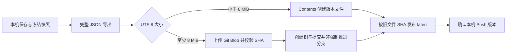

# Nine Rings 跨设备备份架构

更新于 2026-10-17。0.3.0 的 Web/Tauri 已实现逐实体选择、接受基线、同提交发布及可恢复的手动同步；远端仍保存全量不可变 JSON。删除传播、对象分片及自动同步仍为设计。当前正式流程见[同步指南](incremental-sync.md)，下方旧格式流程作为兼容路径保留。

| 文档 | 职责 |
| --- | --- |
| [GitHub 备份指南](github-backup.md) | 当前格式、配置、范围、Push/Pull 与同步诊断 |
| [恢复协调](backup-restore-coordination.md) | 本机保存屏障、互斥、中断检测及回退边界 |
| [增量建议评估](incremental-backup-assessment.md) | 最初/v2 评估、历史测量及逐项问题回复 |
| [手动快照补强设计](sync-snapshot-hardening-design.md) | v3/v4.1 评估、升级切换、实体基线、发布恢复与测量要求 |

## 当前数据流

8 MiB 是应用选择上传通道的阈值，不是 GitHub 的公开限额。两条路径均保留原完整 JSON、版本化文件名与文本 latest；不压缩、不改变正文，也不按文档拆文件。大快照路径由 `src/lib/sync/github-large-upload.ts` 实现；空仓库在未发布版本路径初始化，完整快照确认后才发布 latest。数据与指针仍分步发布。

Pull 先取 latest，再取对应快照；大文件下载可使用 Git Blobs。Web/Tauri 复用 `backup-merge.ts` 做共同基线三方比较，支持冲突决定和副本，不以 updated_at 较大者自动覆盖。远端已有本机未合并版本时 Push 停止并要求安全 Pull。

JSON 导入与 GitHub Pull 复用恢复协调器；中断不自动重放。上传任务独立于设置页，准备快照期间暂停编辑，开始网络上传后可继续编辑，新变化留给下次 Push；不能再将其描述为全程界面冻结。

## 数据与能力边界

- 本机内容优先，网络失败不丢弃本地编辑。全量导出范围以使用指南为准，不含凭据、普通本机版本历史、回收站或 PDF/EPUB 独立资料库。
- Web、PWA、macOS/Windows/Linux Tauri 共用 TS 同步层，原生网络和存储往返仍需分别验证；Flutter 的合并、加密与未知字段能力不等价，不能以可构建代替数据兼容。
- 基线目前是版本标识，需下载旧快照比较；逐实体已接受基线及可恢复发布确认尚未实现。
- 安全合并不传播远端删除，不提供默认自动 Pull、自动同步或跨端最后写入者胜出策略。
- 本机恢复锁不是整个工作区的跨库事务，也不能约束旧客户端或独立外部数据库写入。

## 演进原则

1. 先测实际完整导出、传输、内存和备份仓库增长，再选择格式；不能从单个文件大小或源码仓库推断备份成本。
2. 新格式先实现读取/拒写及共享向量，再开启写入。本轮不支持旧客户端，先升级全部参与设备再切换，不以新增头部宣称能阻止旧程序写入。
3. 按实体确认基线，明确忽略、冲突和上传中新增编辑；配置与模板也必须有冲突规则。
4. 以共同基线判断修改，字段关联组一起处理。正文 NFC/换行、Delta 有序数组及密文不能为获得稳定哈希而静默改写。
5. 先补同提交发布和不确定结果的只读核实；远端发布与本机确认并非同一事务，不盲重试写请求。
6. 删除、附件外置、保留与重写历史分开交付。传播删除先预览和明确授权，保护内容不外置成明文资源。

具体批次与退出条件以[手动快照补强设计](sync-snapshot-hardening-design.md#9-分批落地与退出条件)为准；本次设计更新没有迁移现有备份仓库。

## 其他后端

未来仍可评估 WebDAV、自建 API 或其他对象存储。传输适配器只负责读写和身份/并发约束，不能隐藏为已有 StorageAdapter 的增量能力。每个后端都需证明不可变快照、完整读取、发布一致性、认证隔离及结果不明恢复；不先承诺固定实现天数。WebSocket、实时协作和服务端 changelog 不属于当前手动快照路线。
