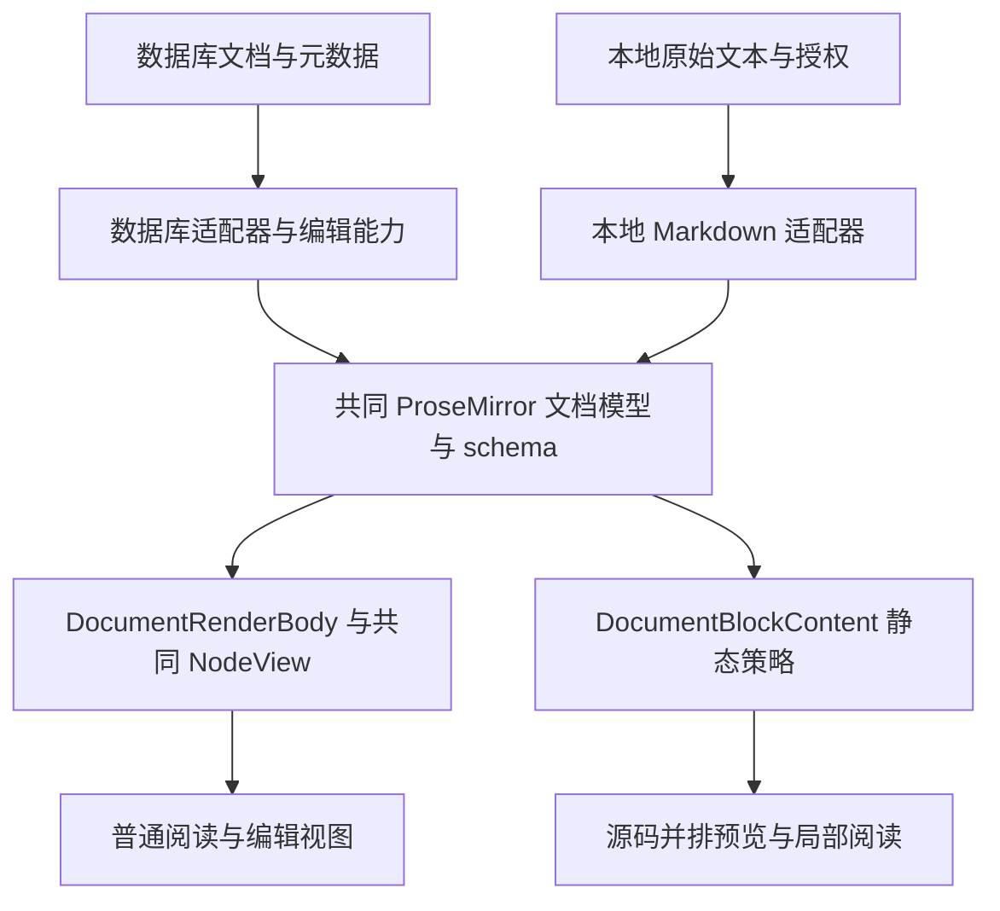

# 共享文档渲染

更新：2026-10-28。

## 目标与边界

相同文档模型、排版配置和阅读状态，在数据库文档与本地文件的普通渲染模式下使用同一套 schema、NodeView、正文容器和块控件。公共阅读外壳样式位于 `styles/document-reading.css`，通过全局样式入口加载，不依赖本地文件分栏是否被加载。文档来源不能决定段落或代码块如何排版。标题栏、保存目标、权限请求、同步和版本历史由来源适配层负责。

只读是普通正文内核的一项能力，不再为本地 Markdown 单独维护静态块包装层。可编辑数据库文档继续使用原有事务和撤销链；本地文件的普通渲染是只读投影，编辑在源码会话进行，不把 TipTap 序列化结果写回原始 Markdown。

## 模块职责

| 模块 | 职责 | 不拥有的内容 |
| --- | --- | --- |
| `extensions/document-rendering.ts` | 创建共同 schema、代码／引用／HTML／图片／表格等 NodeView、行内格式和基础布局扩展；提供只读事务门禁 | 文档 ID、磁盘服务、备份、保存回调 |
| `DocumentRenderBody` | 普通正文的布局边界、gutter 插槽和 `DocumentEditorContent` 挂载 | 标题栏、侧栏、正文保存 |
| `DocumentReadingView` | 在普通内核上提供只读阅读能力：章节折叠、查找、块跳转、块菜单、书签回调、特殊块和块工作区 | 读取文件、数据库访问、配置存储、正文提交 |
| `MarkdownReadingView` | 本地 Markdown 适配器：文件身份、原文摘要、设备本地阅读状态的加载和保存 | 段落／块 DOM、排版与折叠控件实现 |
| `FullNoteEditor` | 数据库文档适配器及编辑能力：事务、撤销、保存、文档元数据和宿主菜单 | 另一套普通正文 schema 或来源专属块间距 |
| `DocumentBlockContent` | 无 EditorView 的静态块呈现策略，供局部渲染、源码并排预览和 Flow 内容复用 | 数据库文档外壳、文件服务 |
| `restoreDocumentViewport` | NodeView 挂载与布局变化期间的阅读位置恢复，支持真实输入与显式跳转取消 | localStorage、数据库或文件身份 |

`ReadonlyVirtualNote` 保留为数据库局部渲染适配器，负责可见范围、测量和分栏，不再拥有可被其它组件反向导入的通用块渲染函数。它和源码并排预览使用共同 schema 与 `DocumentBlockContent`。局部渲染仍默认关闭；本次没有把普通阅读自动改成窗口化。

## 数据与能力流

来源适配器提供模型、排版参数、阅读会话和可选操作回调。没有传入的能力不会由渲染层自行寻找数据库或磁盘接口补齐。例如本地书签回调映射到源码偏移，数据库书签映射到文档元数据；代码块和标题本身无需知道这些差异。

## 一致性约束

- 普通正文使用完整的真实块 DOM，不再用 `.vr-row/.vr-block` 包裹每个本地块。相邻边距由相同的浏览器布局及共享 CSS 决定；删除此前跨包装层修补边距的特殊规则。
- 配置通过共同 CSS 变量以及现有运行时设置接口生效。编号、相对序号、折叠符号和 gutter 几何均由 `EditorBlockGutter` 及编号插件负责。
- 只读事务门禁拒绝正文编辑，即使调用命令或收到原生粘贴事件，也不能改变只读正文。引用折叠的既有显示事务例外不修改原始文本；本地适配器不提供正文保存回调。
- 代码折叠、只读换行和 HTML 展开使用 `ReadingBlockSession` 的显示状态。数据库可使用既有持久化会话，本地适配器注入独立 Map；渲染内核不根据路径或数据库 ID 查找状态。
- 阅读状态属于设备，原文摘要失效时不把旧块偏移应用到新正文。授权图片地址等派生资源变化可重建投影，并继续使用同一阅读会话。
- 普通数据库和本地阅读共用滚动恢复过程。布局尚未稳定时不能把临时夹取的位置覆盖保存值；滚轮、触摸、按键和显式跳转优先结束恢复。
- React NodeView 是 portal。链接和脚注悬停委托到实际 EditorView DOM，不能只依赖 `EditorContent` 上的 React 事件。
- 复制与选择读取完整文档模型或原始文本，不包含块号、工具栏和行号。打印及数据库专属功能继续由宿主处理。

## 验证

`e2e/local-reading-spacing.spec.ts` 把同一 Markdown 分别交给数据库只读视图和本地阅读视图，比较实际相邻块边缘距离，而非只比较 CSS 变量。覆盖经典及七种风格、390px／1280px、连续标题、段落、列表、代码、引用、分隔线、HTML 折叠以及自定义排版参数。

`e2e/local-markdown-rendering.spec.ts` 覆盖只读事务／粘贴拒绝、代码行号即时切换、块模式、查找与跳转、共享本地书签、脚注／目录、源码保真、源码撤销及模式往返的阅读状态。数据库既有的只读、块工作区、导航历史、局部渲染和共享排版用例继续验证原有能力。

普通本地阅读现在也创建一个只读 EditorView，以复用相同 NodeView 和选区／折叠机制；不为每个块创建独立编辑器。本次优先验证一致性，不据此宣称首屏时间或峰值内存改善；大文件性能变化仍需独立基准，局部渲染没有自动应用到本地文件。

原生 IME、系统文件选择和实际权限续期仍按对应平台验收；共享渲染不增加磁盘写权限，也不改变同步协议。
