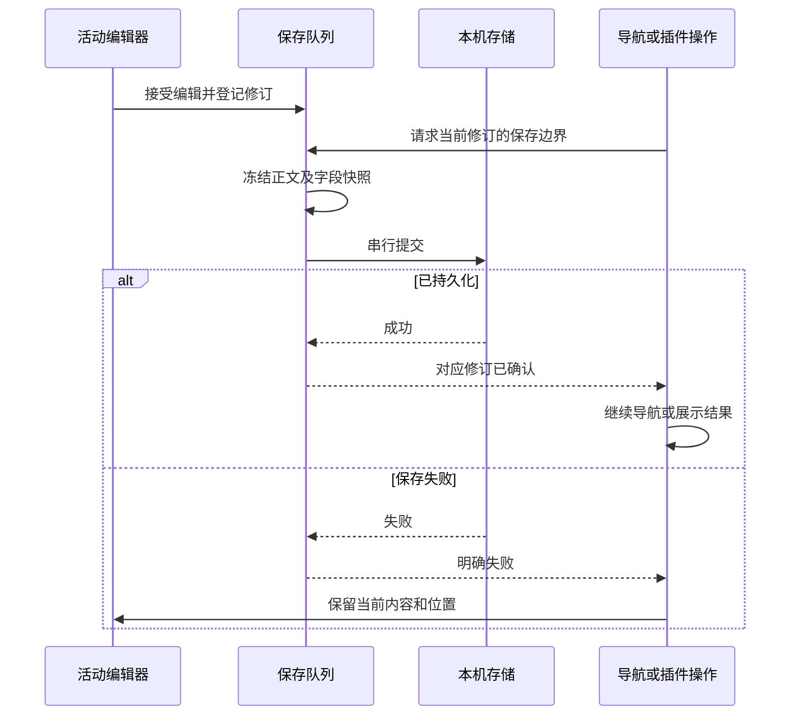

# Nine Rings 工程设计地图

核对日期：2026-10-18。本文提取当前实现的模块边界、设计依据和可复用方法，配合[关键设计](current-design.md)阅读。具体行为以源代码和对应契约测试为准；历史方案不自动成为已经交付的承诺。

## 模块与事实来源

| 模块 | 关键实现 | 决策及约束 | 专题 |
| --- | --- | --- | --- |
| 工作区及会话 | `App.tsx`、`useNoteSessionBoundary`、编辑会话缓存 | 首页是展示状态；普通文档最多三份完整会话，保护文档另行释放 | [布局](workspace-layout.md)、[首页](web-workspace-chrome.md) |
| 编辑权威 | `NoteEditor`、`MarkdownSourceEditor`、Delta/Markdown 转换器 | 活动模型与持久投影分开；保存回执不替换活动模型；两套撤销历史独立 | [权威协议](editor-authority-and-workspace.md)、[Markdown](markdown-compatibility.md) |
| 保存与修订 | `auto-save-queue.ts`、`document-save-revisions.ts` | 接受修订与持久确认分开；延迟正文读取器在 flush 时冻结；失败仅重排未被更新覆盖的字段 | [前置审计](plugin-readiness-audit.md) |
| 存储 | `api.ts`、`storage/`、Rust commands/service/db | UI 经过统一门面和保护层；Schema 是跨端字段来源，不以平台实现自行定义 | [文档系统](document-system-design.md) |
| 定位 | `useEditorNavigation`、`document-navigation.ts`、源码位置映射 | 普通近距位置合并；显式跳转独立；选择、滚动、视图修订不是一个坐标 | [导航历史](document-navigation-history.md) |
| 大文档 | `ReadonlyVirtualNote`、块号/目录视口控制、转换 Worker | 避免每次选区更新遍历全文；虚拟只读保留能力门禁与回退，不冒充编辑虚拟化 | [大文档](large-document-performance.md) |
| 插件运行时 | `plugin-system/runtime.ts`、`lifecycle.ts`、各资源 registry | 激活身份由宿主签发且校验对象身份；块菜单展示只取得宿主菜单模型，不取得编辑器对象或命令回调 | [插件设计](plugin-system-design.md) |
| 源码导航展示 | `MarkdownSourceWorkspace`、`source-symbols.ts`、`source-word-occurrences.ts`、`builtin-source-*-display.ts` | 符号解析、匹配、选区与导航由宿主持有；独立展示插件只调整两个侧栏的有限样式和辅助信息 | [源码类型与导航](document-source-languages.md) |
| 声明式包 | `package-validation.ts`、`package-store.ts`、`installed-packages.ts` | ZIP/Schema/语义预算与指纹审查；更新重新确认；仅宿主执行固定动作，不加载包内代码 | [安装](plugin-package-installation.md) |
| 分栏/主区域 | `panel-registry.ts`、`main-view-registry.ts` | 分栏与中央视图是不同贡献；pending 通过宿主保存边界后才能成为 current | [主区域](plugin-main-area-views.md) |
| 图片 | `image-library/`、`ImageViewerDialog`、Rust image_library | 授权目录只读且设备本地；适窗与原始像素倍率分开；预览变换不改文件 | [图片插件](plugin-local-image-panel.md) |
| 本地文件夹工作区（只读首期） | `local-files/`、`LocalFilesPanel`、`LocalFileView`、Rust `local_files` | 独立目录授权与只读中央视图；写入仍属后续规划，不自动导入或同步磁盘文件 | [方案](local-folder-workspace.md) |
| 词汇 | `vocabulary/`、`builtin-vocabulary.ts` | 普通 Markdown 和独立词库共享资源身份接口；不强迫每词一篇文档 | [词库](vocabulary-corpus-design.md) |
| 同步 | `sync/entity-review.ts`、`reviewed-publication.ts`、`pull-application.ts` | 固定远端修订、冻结本机候选、显式逐实体选择；发布与接受基线分开 | [手动同步](incremental-sync.md) |
| 恢复 | `backup-restore-coordination.ts`、`publication-recovery.ts`、桌面 lifecycle | 不确定写入先只读核验；中断留证据而不盲目重放；数据库恢复不是跨存储原子事务 | [恢复协调](backup-restore-coordination.md) |
| 发布/更新 | PWA 服务工作线程、`src-tauri/`、隔离工具脚本 | 下载不等于激活；构建不等于打包签名；原生行为单独验收 | [更新](pwa-updates.md)、[工具链](local-toolchain.md) |

表中 `src` 文件名默认相对 `src/components`、`src/hooks` 或 `src/lib`；Rust 位于 `src-tauri/src`。并非所有扩展都已经成为第三方公开 API。

## 跨模块时序

这个边界用于防止“界面已经显示成功”被误认为“当前编辑已落盘”。重启恢复、版本快照与远端发布还各有自己的确认记录，不共享一个模糊的 saved 标志。

## 关键取舍与替代方案

1. **宿主解释展示，插件声明资源。** 树、目录、编号、状态栏等复用宿主模型与控件，减少与选区、权限、焦点和移动布局的耦合。代价是新增展示能力需要扩展宿主契约；当前不接受任意 CSS 或第三方 UI 脚本。
2. **源码保真与结构化编辑并存。** 保留原文直到实际富文本修改，再进行结构化序列化。这样能保留原始脚注位置等作者写法，但不能承诺结构化修改后字节级无损，也不能跨两种模型直接复用撤销步骤。
3. **保存使用代次而非时间戳竞争。** 时间可相同、系统时钟会改变；对象身份、存储代次和明确修订分别约束异步结果。旧回调不能覆盖新会话或撤销新 provider。
4. **保留少量会话，缓存派生结果。** 三份文档会话保存撤销和阅读体验；完整 DOM 仍有成本，所以先优化索引、测量和任务调度，再对只读启用受限虚拟化。
5. **手动同步不假装实时协作。** 先预检、再确认、再发布/应用；远端使用固定修订与非强制更新，本机选择和接受基线单独认证。全量快照仍存在，逐文档对象传输、自动删除传播与定时同步不能从名称“增量”推断。
6. **内容、设备偏好和秘密分开。** 本机目录授权、插件安装与凭证不等于文档内容；备份使用显式白名单。改动设置时先确认是否应跨设备传播，不能把整个 localStorage 上传。
7. **跨引擎几何是契约。** 以实际可视内容、滚动条占宽和共享内边距计算标题/工具栏/页脚边界；不依赖某个平台隐藏滚动条的默认值。

## 可复用的实现方法

- **异步重整队列：** 偏好变化递增 revision，串行 reconcile 在 await 前后检查 revision/stopped，资源清理还检查 generation。适用于监听目录、插件启停和工作区恢复。
- **不可变快照 + 订阅：** registry 暴露稳定快照与 subscribe，React 使用 `useSyncExternalStore`；先更新状态，再通知，观察者异常不能阻止撤权。
- **展示所有权：** provider 生效时暂停内置控件而不覆盖原偏好；停用后自然恢复。不要为“恢复默认”写回一份猜测的用户设置。
- **保留操作入口：** 导航从标题迁移到状态栏时，隐藏栏或隐藏该信息项都必须有回退；不因配置隐藏而丢失基本能力。
- **保留命中区，减弱视觉：** splitter 可见线宽为 1px，拖动区仍为 6px；视觉简化不等于缩小可操作面积。
- **固定倍率基于原始像素：** 图片适窗比是坐标换算，不是用户倍率。200% 应得到原图宽高的两倍，而非适窗后的两倍。
- **模态焦点与点击样式分开：** 鼠标打开时聚焦弹层并保持焦点圈安静；返回保留逻辑焦点。键盘仍有可见提示和受限 Tab 循环，不能为消除高亮对所有按钮调用 blur。

## 验证方法与经验

| 问题 | 有价值的证据 | 不足以证明 |
| --- | --- | --- |
| 保存竞争 | 旧提交失败期间继续输入，检查新值和失败恢复队列 | 单次保存成功 |
| 插件代次 | 快速启停、替换及迟到 cleanup，验证旧句柄失效 | 注册函数能返回 |
| 恢复位置 | 不同窗口尺寸重启、首页往返、字体/图片迟到布局 | 只检查存储的 scrollTop |
| 跨引擎布局 | Chromium/WebKit，固定目录、并排预览、不同风格，等待真实编辑器挂载后比较边界 | 单张截图或只测外层容器 |
| 触控与选择 | 真实拖选/复制、折叠双击、输入法及原生手势 | 直接 dispatch 成功 |
| 同步安全 | 固定修订、并发远端变化、上传结果不明、重启恢复与不兼容格式拒绝 | Mock HTTP 200 |
| 性能 | 同一 fixture、相同模式、工作量与时间分开记录 | 不同机器一次运行快慢 |

运行浏览器测试时串行使用共享端口；不要在运行中编辑前端造成 HMR 重新加载。WebKit 的 Tab 遍历可能受系统全键盘访问设置影响：测试应控制能力前提，并保留真实键盘激活、焦点恢复及弹层内循环的行为断言。类型、lint、单元/契约、浏览器和原生验证分别报告，定向通过不能称为整个产品 E2E 通过。

## 当前边界与后续入口

原生菜单迁移暂不实施。公开第三方脚本、任意 renderer、跨视图共享撤销、实时多人协作及 iOS Tauri 迁移均不是本文宣告的已交付能力。用户双端同步验收与本机浏览器验证分开记录。后续审查应从这些边界进入，先复现和更新契约，再实现扩展。
